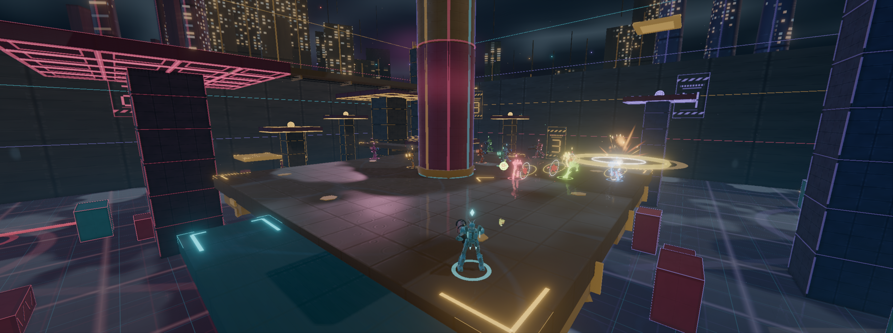
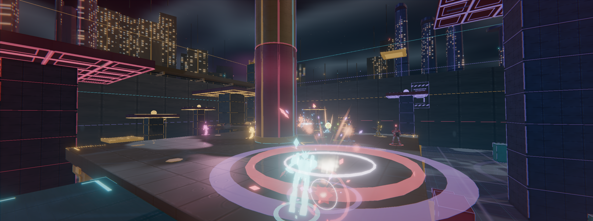
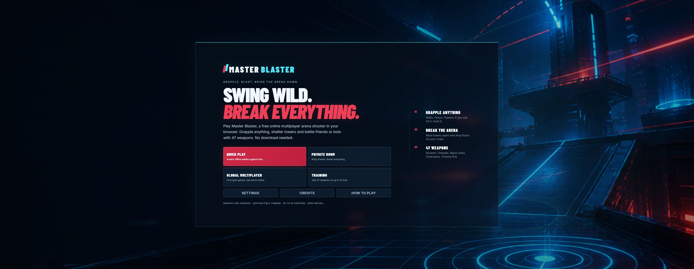
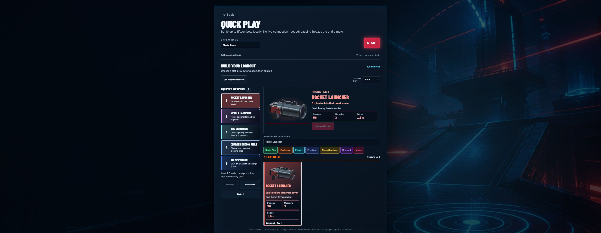

# Master Blaster community post drafts

The latest [General feedback post on the editable Page](https://chatgpt.com/space/page_6f014dc1bbfc81919de2edf967cf18bf) is the default for all future outreach emails and posts, authorized by the user on 5 October 2026. Read it before preparing outreach. This file is a snapshot; Page and file edits do not sync automatically.

Adapt greetings, recipient references, subject/title, length, community format and source tags as needed while preserving the user's story and feedback request. The supplied father-and-son story is authorized; do not add names, account-derived details or additional creator information. The older Codex draft was removed from the Page and is no longer a separate default. Existing publication, moderation, human-verification and manual-posting constraints still apply.

## General feedback post

Snapshot refreshed 20 October 2026 for the next outreach package. All four new
screenshots passed capture review; their public downloads were verified byte-for-byte.
The [new target shortlist](https://chatgpt.com/space/page_c0971087828481918cae6c2678c0f41d)
shows the eight authorized targets and current submission states. Existing published posts and sent messages retain their original copy.

**Title:** Master Blaster — free browser arena shooter with grappling and destructible towers

My son, who’s 8 years old, is working on Master Blaster, a free browser arena shooter where you can grapple and swing across the map, blast opponents and bring towers down. There are 47 weapons to choose from, with five in your loadout. He’s building it with AI-assisted coding, and my job as his dad has been to help him set up the needed accounts and help with marketing :)

Please check the game out. You can play Quick Play or Training against up to 15 bots, invite friends to a Private Room, or find or create a game in Global Multiplayer. It runs in your browser with no installation and no in-game chat.

Quick Play and Training can also work offline after the home menu finishes preparing resources and shows “Available offline.” That depends on your browser retaining the saved resources; online multiplayer needs an internet connection.

**Play:** [Play Master Blaster](https://masterblaster.se/?ref=community&utm_source=community&utm_medium=community&utm_campaign=first_players&utm_content=showcase)

**Controls and game modes:** [How to play](https://masterblaster.se/how-to-play/?ref=community&utm_source=community&utm_medium=community&utm_campaign=first_players&utm_content=guide)

We'd love feedback, especially on:

- Do the movement, grappling and weapons feel right?

- Is the game fun?

- What would you change first to make you want to play more matches?

If something breaks or runs poorly, please tell us what happened, your device and browser, and which game mode you were playing.

Thanks for giving it a go!

## Screenshots

**20 October capture package — reviewed and public downloads verified.**
The four files are captured, inspected and included in pushed commit 51214dd.
Regular-browser downloads from Cloudflare match all four source SHA-256 hashes.
Earlier files remain unchanged for historical posts. Both action captures record
15 bots/16 fighters, real AI combat, zero renderer errors and no direct fallback.
Starting positions and loadouts were staged; no explosions were injected.

### Rocket action with 15 bots

Rocket Launcher equipped during a 15-bot battle. Staged starting positions; live AI combat.

[Download rocket image](https://masterblaster.se/press/action-rockets-2026-10-20.png)

### Close-range blast from the player camera

Close-range blast during a 15-bot match, with Grenade Launcher equipped. Player camera; staged starting positions; live AI combat.

[Download grenade image](https://masterblaster.se/press/action-grenades-2026-10-20.png)

### Home menu

Master Blaster home menu, captured from production on 20 October 2026.

[Download home-menu image](https://masterblaster.se/press/home-menu-2026-10-20.jpg)

### Quick Play with 15 bots

Quick Play setup with 15 veteran bots and all five loadout slots. Rocket Launcher selected, with its full preview and filtered weapon card visible.

[Download Quick Play image](https://masterblaster.se/press/quick-play-2026-10-20.jpg)

Action images are 3394 × 1269 PNGs: rocket 6,393,504 bytes and grenade
6,250,771 bytes. Both exceed a 4 MB attachment cap; a separately reviewed smaller
export is required before using them on a destination with that limit. Menu
images are 3394 × 1316 JPEGs: home 219,714 bytes, Quick Play 193,491 bytes.
Quick Play SHA-256:
57639c2e77f653b0e09c4fcff643712206fe111179a4804dadda85481b867b35.

Historical package: action-rockets.png, action-grenades.png, home-menu.jpg and
quick-play-loadout-2026-10-05.jpg remain unchanged. The 5 October Quick Play
image was exported unchanged from the user's Page attachment (SHA-256
2a981e0141f9335b9956fb740fdc277d747070f49eaa12c64b65d4c1c14294c3).
Its prior verification does not establish delivery of the new dated package.
Keep staged-scene captions; do not imply an earned headshot, a player-fired blast
or 16 human players without evidence.
